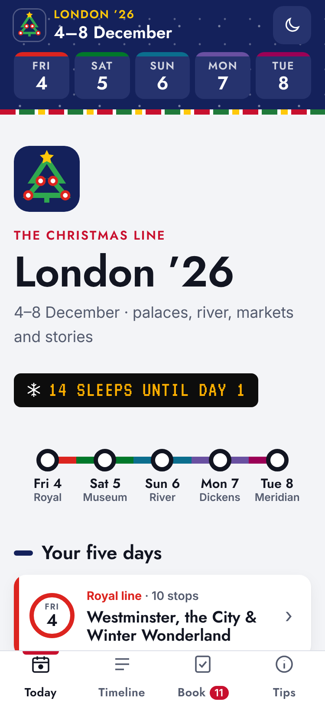
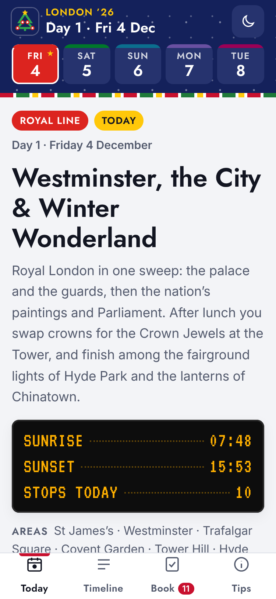
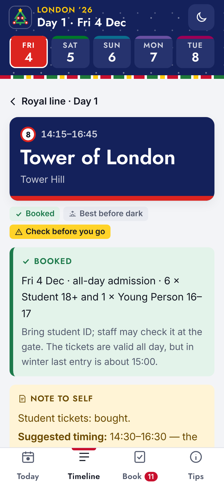
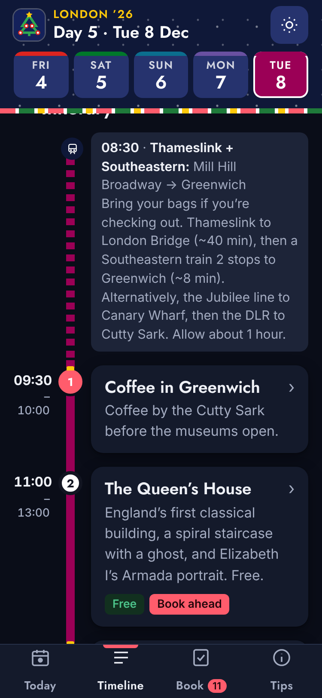

# London ’26: a pocket guide

A phone-first, offline-capable web app for a five-day London trip (Fri 4 – Tue 8 December 2026). It shows a day-by-day timeline, and each stop opens a story-led guide: history, fun facts, things to look for, practical details, sources, and your own notes.

| Home | Day | Stop page | Dark mode |
|---|---|---|---|
|  |  |  |  |

## What's in it

- **Today**: during the trip it opens on today's day. Before or after the trip it shows a day picker with a countdown. Each day has a "nutshell" intro, its neighbourhoods, sunrise and sunset (calculated on the device), and a "best before dark" list that flags stops scheduled too close to sunset.
- **Timeline**: numbered stops with times, teasers and your notes, plus travel legs between them. Swipe left or right or use the day tabs to change day. The sticky header shows *Day X · date*.
- **Stop pages**: story, fun facts, "Look for this", a practical box, *Check before you go* tags, a Google Maps link, a "Note to self" box and sources. Food stops get a lighter card.
- **Book**: a booking checklist built from every stop with a `book` field. Ticks are saved in `localStorage` on the phone.
- **Plan check** (`#/plan`): every timing clash and every *Check before you go* item in one list.
- **Tips**: contactless/Oyster caps, getting in from Mill Hill, December practicalities.
- **PWA**: installable, and works fully offline (service worker precaches pages, data, fonts and icons).

No build step and no dependencies: plain HTML, CSS and JS.

**Design, "The Christmas Line":** a transport-map look. Each day is a coloured line (Royal, Museum, River, Dickens, Meridian), each stop is a station on it, clash warnings read like a service-status board, and sun times sit on an amber departure board. Christmas touches: a garland stripe, light snow in the header, a "sleeps until Day 1" countdown, bauble tick-boxes, and a logo of a Christmas tree drawn as a line map. Fonts are Jost, Inter and VT323 (all SIL OFL, self-hosted in `/fonts`). Colours are CSS tokens at the top of `css/style.css`, and each day's line colour lives in `data/itinerary.js` (`line`). The look is inspired by transit maps but uses no TfL trademarks (no roundel, no Johnston typeface).

## Editing the content

Everything lives in **`data/itinerary.js`**. The schema is documented in the comment at the top of that file.

- **Shift the dates:** change `settings.day1Date` (`"2026-12-05"`). Day N = Day 1 + (N-1).
- **Flight:** `flight` holds the Wizz Air details (Luton, W4 3648, 20:25 on Tue 8 Dec) shown on the Day 5 airport page.
- **Add or edit a stop:** copy an existing item. `book` puts it on the checklist, `checks` adds *Check before you go* tags, `light: "day"` adds the sunset warning, `alerts` adds clash notes.
- **After any edit, bump `CACHE_VERSION` in `sw.js`** (e.g. `ldn26-v2`) so installed phones fetch the new version. Open the app twice while online to pick it up.

To test a particular date, add `?today=2026-12-06` to the URL.

## Run locally

```bash
python3 -m http.server 8000
# open http://localhost:8000
```

(The service worker needs `http://localhost` or HTTPS; opening `index.html` as a file works but without offline mode.)

## Deploy for free

All paths are relative, so it works from a sub-path such as `https://<user>.github.io/england-guide/`.

**GitHub Pages**
1. Push this folder to a GitHub repository (e.g. `england-guide`) on the `main` branch.
2. Repository → **Settings → Pages** → *Build and deployment* → Source: **Deploy from a branch** → Branch: `main`, folder `/ (root)` → **Save**.
3. After about a minute the site is live at `https://<your-user>.github.io/england-guide/`.

**Netlify**
1. Go to app.netlify.com → **Add new site → Deploy manually**, and drag this folder onto the page. Or connect the GitHub repo with no build command and publish directory `/`.

**Install on your phone:** open the URL in Safari (iOS) → Share → **Add to Home Screen**, or in Chrome (Android) → ⋮ → **Install app**. Open it once while online, so everything is cached, before you go underground.

## Accuracy

Facts were researched in late October 2026 using official sources where reachable (Royal Museums Greenwich, Southbank Centre, Tower Bridge, Borough Market, Sky Garden, Household Division) and reputable secondary sources otherwise. Each stop lists its sources. Anything that couldn't be confirmed for December 2026 carries a red **Check before you go** tag. The full list is on the in-app **Plan check** page.
